<p align="center">
  <picture>
    <source media="(prefers-color-scheme: dark)" srcset="docs/images/header-dark.png">
    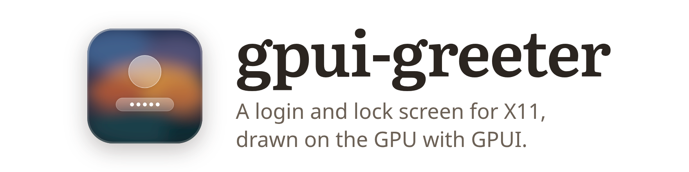
  </picture>
</p>

<p align="center">
  A greeter for greetd on X11, with a lock screen and a settings window.
</p>

<p align="center">
  <a href="https://crazyboycjr.github.io/gpui-greeter/">Homepage</a> ·
  <a href="#install">Install</a> ·
  <a href="#themes">Themes</a> ·
  <a href="#theme-folders">Theme folders</a> ·
  <a href="#lock-screen">Lock screen</a> ·
  <a href="#settings">Settings</a> ·
  <a href="CHANGELOG.md">Changes</a>
</p>

## Why I wrote this

I wrote gpui-greeter for fun. Tiling window managers such as xmonad don't
come with a display manager of their own, and LightDM, SDDM and GDM all look
dated to me, so I made a modern-looking login screen for greetd, and a lock
screen to go with it, with gpui-kit. That's all it is.

## Themes

Frost and Neon come with gpui-greeter, as does Paper further down. XMonad
Bind, XMonad Tall and Arch Linux Console are theme folders I made for my own
machine with the theme skill in the package. They draw the xmonad and Arch
Linux logos, so they stay on my machine and are not part of gpui-greeter;
they are here to show what a [theme folder](#theme-folders) can do.

### Frost

Frost follows macOS's lock screen and login window. At rest it shows the
wallpaper with a large clock and the date; a key or a click blurs and dims it
behind a round avatar, the name and a password field, set low as macOS sets
them, above Sleep, Restart and Shut Down. The sizes are macOS's, point for
point, and a refused password shakes the field in three small swings.

<p>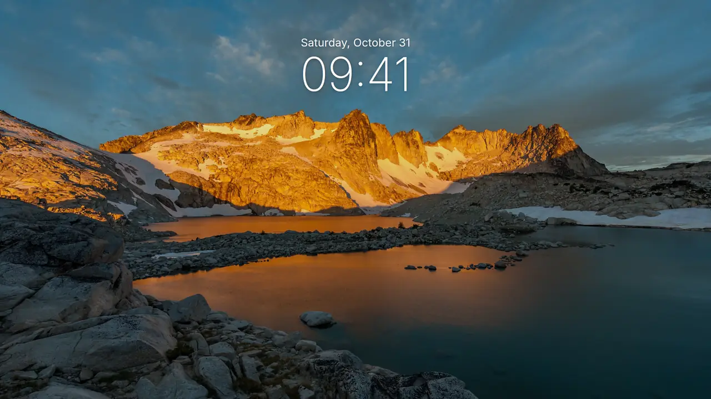</p>

<p>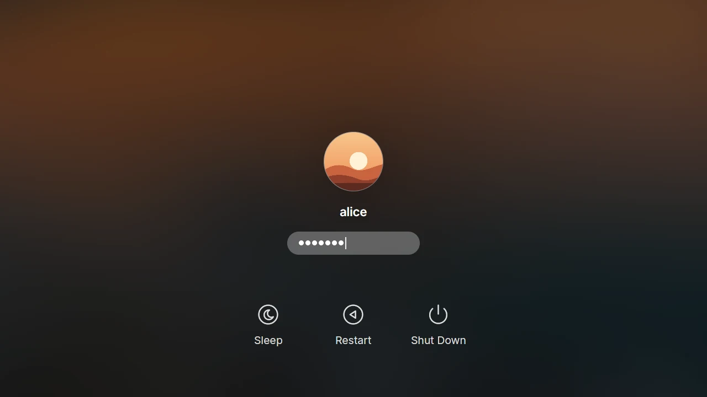</p>

### XMonad Bind

xmonad's classic logo on a dark page, a large clock, and a login written as
Haskell: `login :: User -> Password -> X ()` above
`login alice ••••••• >>= xmonad`, where the red `>>=` logs in and Tab changes
the session after it. A wrong password gets GHC's type error back.

<p>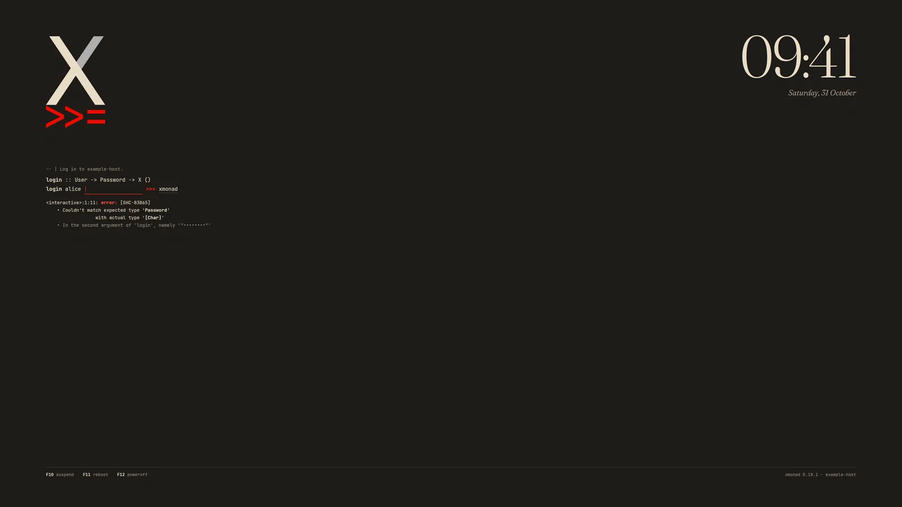>=, at the top left of a dark page, and the clock 09:41 with the date at the top right; under the logo, login :: User -> Password -> X (), then login alice, an empty field, >>= and xmonad, and GHC's error that it couldn't match the expected type Password with the actual type [Char]; F10 suspend, F11 reboot and F12 poweroff along the bottom"></p>

### XMonad Tall

The login tiled as xmonad's Tall layout tiles windows: the form is the master
pane, with tty-clock, a feh slideshow and a list of keys stacked beside it,
and polybar along the bottom. xmonad's own keys work, so mod-j and mod-k move
the focus and mod-space cycles Tall, Mirror Tall and Full. At rest the clock
fills the screen.

<p>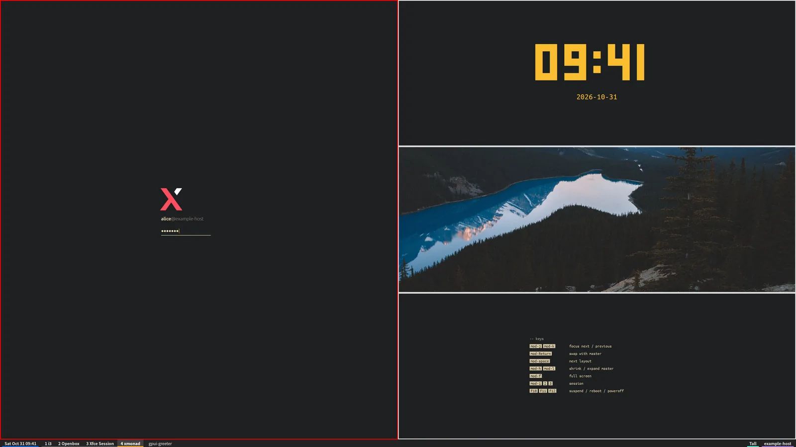</p>

### Arch Linux Console

Arch's login on tty1: the issue line, a fetch block beside the Arch logo, and
the `login:` and `Password:` prompts. The facts are read from the machine's
own files (the screenshot's machine is made up), and a wrong password prints
`Login incorrect`, as getty does.

<p>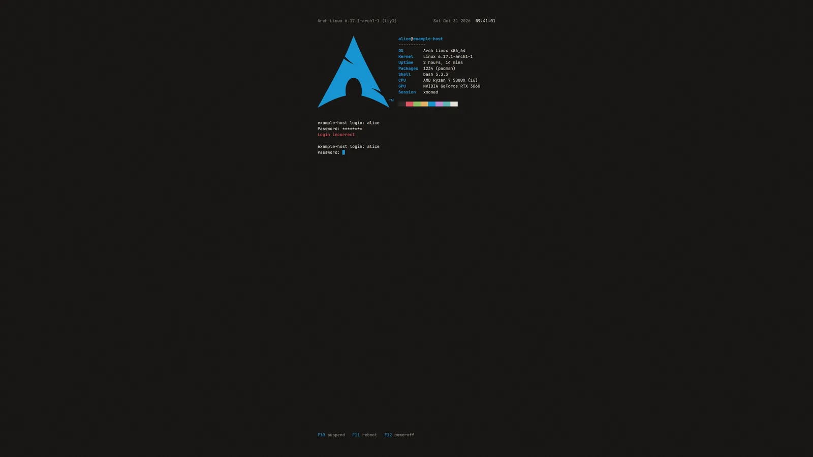</p>

### Neon

Neon puts the machine's name over a terminal panel, on a city at night, a
circuit board with light running along its traces, a synthwave sunset over a
moving grid floor, or a faint grid, all with scanlines and a slow scan beam.
Its status line goes READY, AUTH, then GRANTED or DENIED, and F-keys along the
bottom pick the session, the keyboard layout and the power actions.

<p>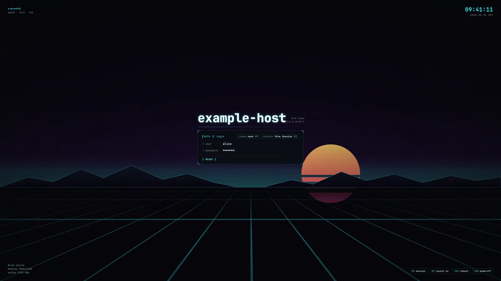</p>

<p>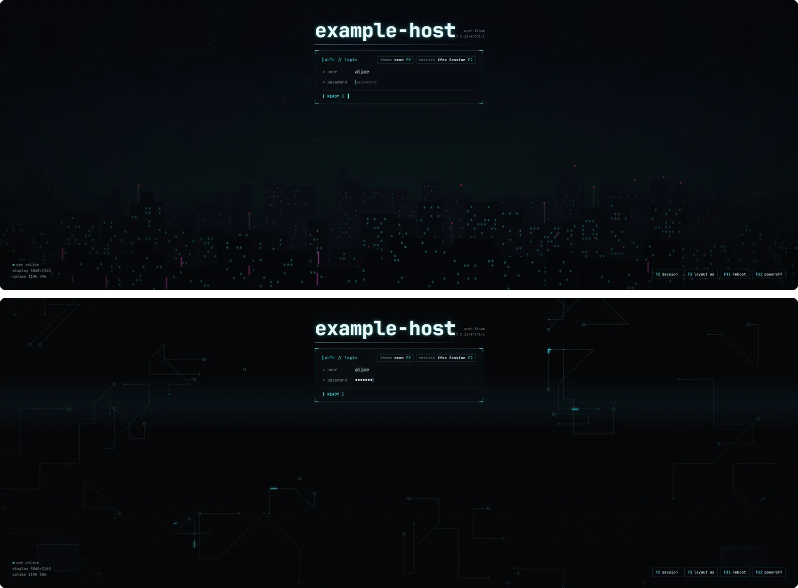</p>

## Theme folders

**Design your own, or ask an agent to.** A theme is a folder: a `theme.toml`
of layers on a 3840 by 2160 frame, with the pictures, SVGs and fonts they
draw, anchored to the screen's edges and centre so they hold on any monitor.
Layers change with the state of the login, can move, and fill in the time,
the user, the session, what PAM says and facts about the machine, read from
files: a theme never runs anything. Theme folders live outside the package,
in `/usr/local/share/gpui-greeter/themes`, and every one is a lock screen too.

This is inspired by [Omarchy](https://omarchy.org), where a theme is a folder
on your own machine that restyles the whole desktop, and Omarchy ships skills
that help your coding agent make new ones. Here the package comes with a
skill that walks an agent such as Claude Code through designing a theme with
you: drawing out the idea, gathering fonts and pictures lawfully, previewing
every state, and installing it. Add it to Claude Code with

```sh
mkdir -p ~/.claude/skills
ln -s /usr/share/gpui-greeter/skills/gpui-greeter-theme ~/.claude/skills/
```

and ask it for a new login screen. XMonad Bind, XMonad Tall and Arch Linux
Console were made this way, and your themes stay on your machine too. The
package's own example is Dial, a clock in a ring of sixty ticks:

<p>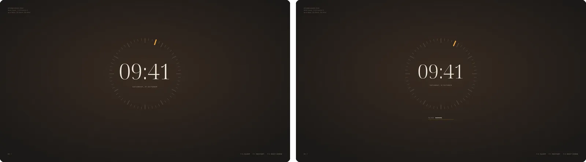</p>

```sh
gpui-greeter check-theme DIR
gpui-greeter preview DIR --state error --lang zh-CN --shot error.png
sudo gpui-greeter install-theme DIR --select
```

`check-theme` names what is wrong by file and line, and a theme that fails it
is never drawn: the greeter shows Paper instead. `preview --shot` draws the
theme in an X server of its own with no display needed. [The format](skills/gpui-greeter-theme/reference.md)
is documented beside an example theme, [dial](skills/gpui-greeter-theme/dial),
and [docs/themes.md](docs/themes.md) has the rest.

## Paper

Paper is the look the greeter starts with: a large Fraunces clock on warm
paper, with the avatar, the name and an underlined password field beneath it.
The paper is a sheet on a wooden desk among a pencil, a fountain pen, a cup of
coffee and a succulent; ledger paper; a drafting sheet whose title block holds
the session and the power actions; or plain. Paper Night is the same on a
walnut desk or a dark ground, and each takes an accent.

<p>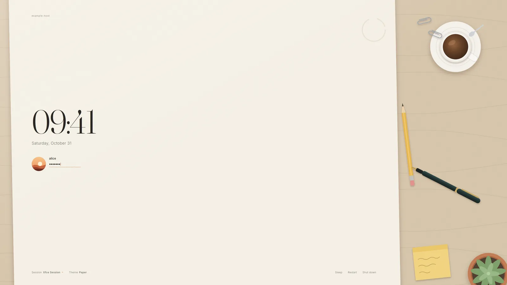</p>

<p>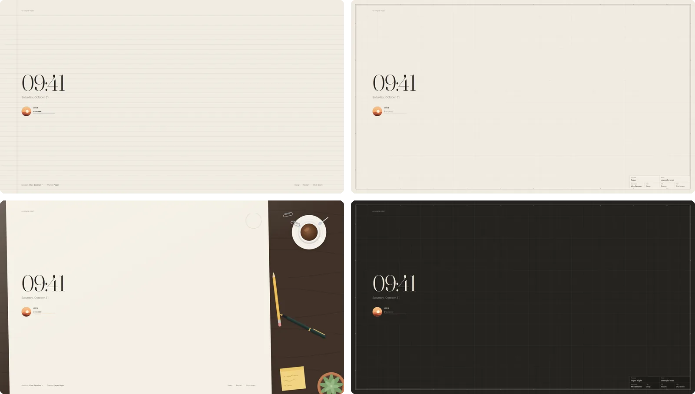</p>

## Switching looks

F9 switches to the next look at the login screen and at the lock screen, and
Shift+F9 to the one before: the built-in looks, then the theme folders you
have installed. The greeter starts with the one picked next time. Tab picks
the session, F10 to F12 sleep, restart and shut down after a second press,
and Escape clears the field or goes back to rest.

<p>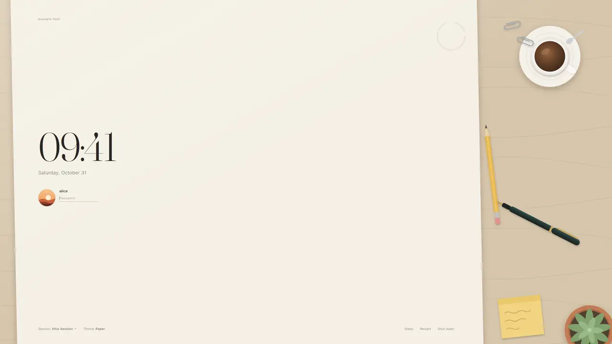</p>

None of the looks says how to log in or how to wake the screen: as on a Mac,
the line under the field stays quiet until there is something to say, a
refused password or a word from PAM.

## Lock screen

`gpui-greeter lock` locks a running X session with the same looks, over every
monitor, under greetd or any other display manager. It starts at rest, the
look's clock and art without the form; the first key only wakes it, and once
the password is accepted every window is as it was.

<p>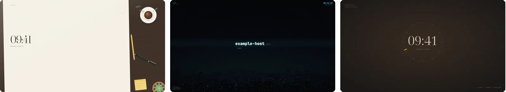</p>

```sh
gpui-greeter lock                    # on a key of your window manager
gpui-greeter lock --when-idle 30 &   # in ~/.xinitrc: lock once the screen has blanked
```

A small supervisor holds the keyboard, the pointer and a black cover, and
checks the password with PAM; the looks are drawn by a second process, which
can crash and start again without ever showing the session. The password is
checked as the PAM service `gpui-greeter-lock`, which the package installs.
[docs/lock-screen.md](docs/lock-screen.md) covers key bindings, xss-lock and
how it holds the screen.

## Settings

`gpui-greeter settings` is a window for the settings used day to day: the
look to start with, each look's background and accent, Frost's wallpapers and
Bing's picture of the day, your avatar, the size and the language. It shows
the look as the greeter draws it, small, and follows each change at once.

<picture>
  <source media="(prefers-color-scheme: dark)" srcset="docs/images/settings-dark.webp">
  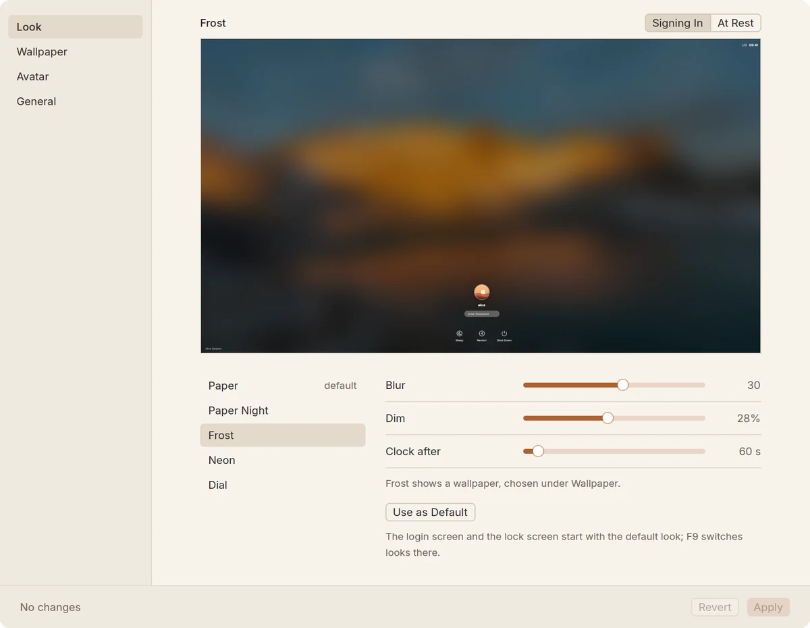
</picture>

Nothing changes until Apply. Your avatar goes to AccountsService; what root
keeps goes through one `pkexec gpui-greeter apply-settings`, which accepts
only the settings the window offers and checks them all first.
[docs/settings.md](docs/settings.md) has the details.

## Details

- **Native density.** The looks are laid out in points, as a Mac lays out a
  display, from each monitor's own pixels per inch: about as large on a
  27-inch 4K monitor as on a 24-inch 1080p one, and as large as macOS's lock
  screen.
- **Every monitor.** Each monitor gets a window of its own, and the form
  shows on the primary one and follows the pointer to another. Nothing is
  tied to a monitor, a port or a mode.
- **Refresh rate.** Each window draws at its own monitor's refresh rate, 240
  Hz included, and follows it as monitors sleep, wake and change modes.
- **No waiting.** The session starts the moment PAM accepts the password,
  with no welcome to wait through.
- **English and 中文.** `language = "zh-CN"` puts every look, the lock screen
  and the settings window in Chinese.

<p>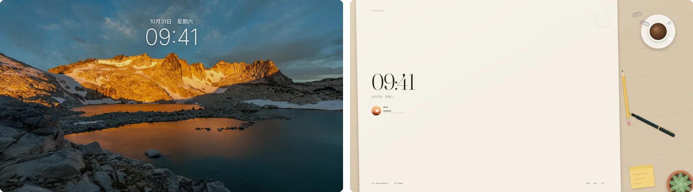</p>

## Install

gpui-greeter runs on X11, as the login screen of
[greetd](https://git.sr.ht/~kennylevinsen/greetd). It needs a Vulkan driver,
an X server with `startx`, PAM and systemd.

On Arch Linux, from the AUR:

```sh
paru -S gpui-greeter
```

Or from this repository, which builds what is on `main`:

```sh
git clone https://github.com/crazyboycjr/gpui-greeter
cd gpui-greeter/packaging/arch
makepkg -si
```

On NixOS, the flake's module sets up greetd with the greeter
([docs/install.md](docs/install.md#nixos)):

```nix
imports = [ gpui-greeter.nixosModules.default ];
services.gpui-greeter.enable = true;
```

### Switching to greetd

Run one display manager at a time: starting greetd while another display
manager's session runs starts a second X server beside it, and on NVIDIA that
session's X server can lose the GPU and end, taking the session with it.

```sh
sudo gpui-greeter-switch greetd    # greetd from the next boot
sudo gpui-greeter-switch lightdm   # and back
```

Nothing starts or stops until the next boot. To switch at once, log out, log
in on a text console (Ctrl+Alt+F2) and run
`sudo systemctl stop lightdm && sudo systemctl start greetd`. The session
greetd starts runs on VT 1, where the login screen was, so Ctrl+Alt+F1 returns
to it from a text console. Stopping or restarting greetd ends that session.

The logs are in `journalctl -t gpui-greeter`, and if the greeter's X server
cannot start, agreety offers a text login on the same VT.
[docs/install.md](docs/install.md) has what the package installs and the rest.

## Configuration

The settings are `/etc/gpui-greeter/config.toml`, which the package installs
with every key and its default: the look, the language, the size, each look's
background and accent, Frost's blur, dim and idle time, the wallpaper folder
and pick, and how sessions start.

```sh
sudo gpui-greeter sync-wallpapers ~/Pictures/Wallpapers
```

copies a folder of wallpapers where the greeter can read them, for Frost; with
`pick = "bing"` it shows Bing's picture of the day instead.
[docs/configuration.md](docs/configuration.md) explains each setting.

## Built with Rust and GPUI

gpui-greeter is written in Rust on [GPUI](https://www.gpui.rs), the GPU UI
framework of the Zed editor, through longbridge's
[gpui-kit](https://github.com/longbridge/gpui-kit), and draws with Vulkan. It
speaks to greetd with [greetd_ipc](https://crates.io/crates/greetd_ipc), to X
with [x11rb](https://crates.io/crates/x11rb), to logind and AccountsService
with [zbus](https://crates.io/crates/zbus), and draws its SVGs with
[resvg](https://crates.io/crates/resvg). How it fits together, trying it in an
invisible X server with `scripts/try`, and the tests are in
[docs/development.md](docs/development.md).

## License

gpui-greeter is licensed under the Apache License, Version 2.0; see
[LICENSE](LICENSE).

The fonts built in, Inter, Fraunces and JetBrains Mono, and the example
theme's Noto Serif Display are under the SIL Open Font License. The
screenshots show a test account, alice, on a machine called example-host,
with an avatar drawn for them. Frost's wallpapers in them, and the slides in
XMonad Tall's, are five photographs by Sergei Akulich, Robert Magnusson,
Peter Winckler, adrian and Ales Krivec, released into the public domain (CC0)
and kept on Wikimedia Commons. The screenshots of XMonad Bind, XMonad Tall and
Arch Linux Console show the xmonad and Arch Linux logos, which belong to their
projects. [docs/images/SOURCES.md](docs/images/SOURCES.md) links each picture
and says under what terms it is shown.
