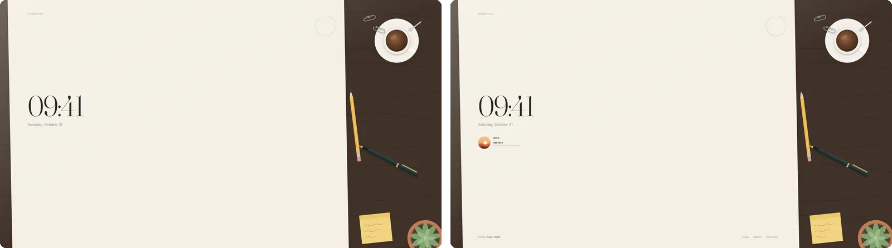

# The lock screen

`gpui-greeter lock` locks a running X session with the same looks as the
login screen: Paper, Paper Night, Frost, Neon and the installed theme
folders, over every monitor. It runs as the user, in their own session,
under greetd or any other display manager.

```sh
gpui-greeter lock
```

<p></p>

It starts at rest, the look's clock and art without the form, for a screen
to leave behind while away. A key, a click or moving the mouse more than a
nudge brings the form, and that first key types nothing, as on a Mac:
Space, Enter or Escape is as good as any. Escape takes the form away again;
F9 and Shift+F9 switch looks there too, and the lock keeps the look picked
for next time in `~/.local/state/gpui-greeter/lock.toml`, until the
settings' `theme` changes. F10 to F12 and the power buttons act as at the
login screen, a second press confirming. The user is the one who locked,
and the session the one running, which is not chosen there: the built-in
looks leave out their session controls, the session keys do nothing, and
a theme folder hides its session row with `locked` (see
[the format](../skills/gpui-greeter-theme/reference.md)). Once the password
is accepted the lock is gone at once, and every window is as it was. Its
drawn backgrounds are kept in the user's own `~/.cache/gpui-greeter`.

## Locking with a key

Have the window manager run it. In xmonad's keys:

```haskell
, ((modm .|. shiftMask, xK_l), spawn "gpui-greeter lock")
```

In i3's config:

```
bindsym $mod+Shift+l exec --no-startup-id gpui-greeter lock
```

Any other window manager's key bindings, or a key daemon such as sxhkd,
run the same command.

## Locking when the screen blanks

To lock once the screen has gone blank, let the lock wait for it in the
session, say from `~/.xinitrc` before the window manager starts:

```sh
gpui-greeter lock --when-idle 30 &
```

It locks once the X screen saver has kept the screen blank for 30 seconds
(`xset s 600` blanks it after ten minutes without a key or the mouse;
`xset s blank` blanks rather than draws a pattern), so that whoever wakes
the screen finds the lock at rest with its clock, and at once on
`loginctl lock-session`; `loginctl unlock-session` ends the lock it
started. It costs nothing while it waits, starts no lock while one runs,
and the lock keeps the screen blank: nothing is drawn until a key or the
mouse wakes the screen, and the move that wakes it leaves the lock at
rest.

xss-lock does the same when the screen saver starts, and locks before a
suspend too, waiting until the lock is showing:

```sh
xss-lock --transfer-sleep-lock -- gpui-greeter lock &
```

A second lock started while one runs waits for that one and ends with it.
Whatever started it, a lock takes its look off the screen while the
screen saver has the screen blank, and puts it back when it lights up.

## The password

The password is checked by PAM as the service `gpui-greeter-lock`, which
the package installs as `/etc/pam.d/gpui-greeter-lock`:

```
auth       include      system-auth
```

so as at a login: pam_unix checks it through its setuid helper, PAM waits
a moment after a wrong one, and faillock counts the refusals and says
when the account is locked. Without that file the lock refuses to start,
since no password could end it.

## How it holds the screen

The process the command starts is the supervisor. It covers the screen
with a plain black window, out of the window manager's hands, above every
other window, docks and fullscreen ones included; it raises it again
whenever another window is mapped or raised, and covers the screen again
when the monitors change. It holds the keyboard and the pointer for as
long as the screen is locked: a window manager's key bindings do nothing,
and no other window gets a key or a click. When another program holds
them for more than two seconds, as an open menu may, the lock says so and
ends, rather than seem to lock. The supervisor checks the password with
PAM and draws nothing else.

The looks are drawn by its view, a second process, which it starts and
hands the keys and the pointer to, and which hands it back what was
typed; both wipe the password from memory once it is sent. Should the
view crash, hang or fail to start, the cover and the grabs stay, the view
starts again, and meanwhile the cover takes the password itself: a line
where it goes, a square for each character, Enter to unlock.

The cover and the view's windows ask a compositor to keep compositing
them (`_NET_WM_BYPASS_COMPOSITOR` set to 2) rather than unredirect them,
as many do with a window over a whole monitor: a full-screen window that
flips by itself on NVIDIA gets variable refresh, whose uneven pace can
black out a monitor such as an OLED.

What it cannot do: the supervisor is what holds the screen, so if it ends,
by a bug or a signal, the X server lets go of its grabs and its cover and
the session shows, as with any X screen locker; it is kept small for that.
Programs running as the user can end it, as they can any of the user's
programs. And the X server switches to another VT on Ctrl+Alt+F2 whatever
holds the keyboard, so a text console logged in there stays usable.
