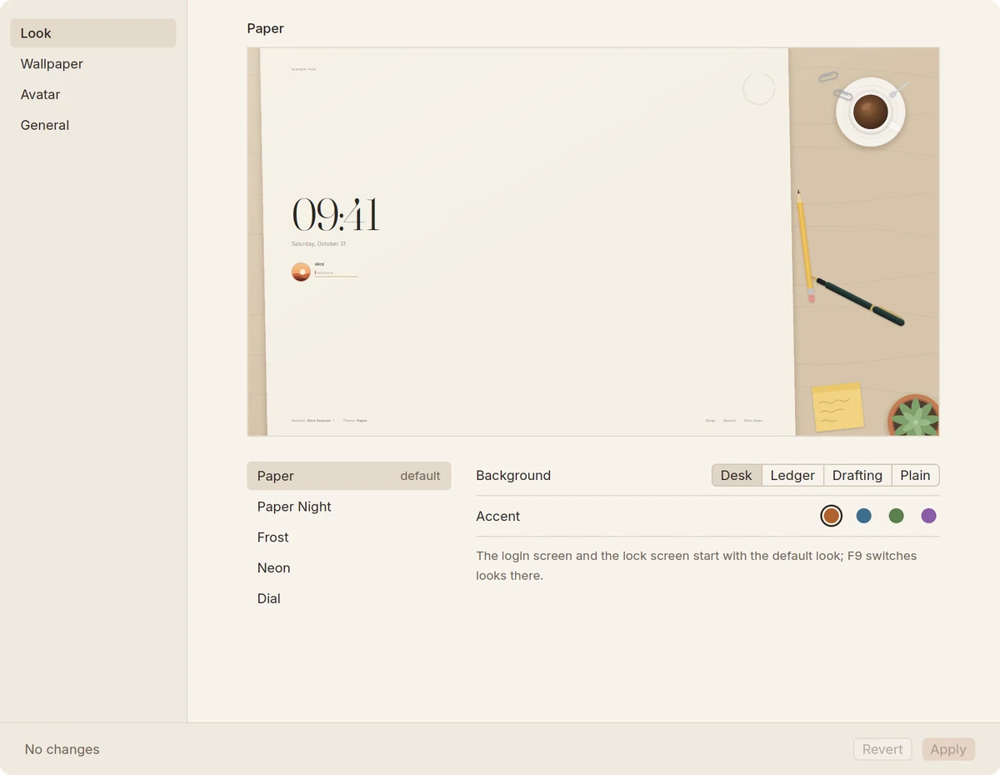

# The settings window

`gpui-greeter settings`, "gpui-greeter Settings" among the applications,
is a window for the settings used day to day: the look the login screen
and the lock screen start with, each look's background and accent, Frost's
wallpapers and Bing's pictures, your avatar, the size and the language. It
shows the look as the greeter draws it, small, signing in or at rest, and
follows each change at once.

<picture>
  <source media="(prefers-color-scheme: dark)" srcset="images/settings-look-dark.webp">
  
</picture>

```sh
gpui-greeter settings
gpui-greeter settings --section wallpaper
```

`--section` opens it at `look`, `wallpaper`, `avatar` or `general`.

- **Look**: the look to start with, among the built-in ones and the
  installed theme folders, each look's background and accent, and Frost's
  blur, dim and idle time.
- **Wallpaper**: Frost's pictures, added from your own folders or removed,
  one picture always or another at each start or each day, or Bing's
  picture of the day, with the pictures Bing has given so far.
- **Avatar**: your picture, cut to its middle square and set through
  AccountsService for your account only, which the looks show in their
  round frame.
- **General**: the size of every look, and the language of the login
  screen, the lock screen and the window itself.

Nothing changes until Apply. The avatar goes to AccountsService, which
lets everyone set their own. The settings file, the wallpaper folder and
the daily Bing timer are root's, so Apply runs `gpui-greeter
apply-settings` once through pkexec, and polkit asks for the password.
That helper reads the changes from its standard input, pictures included,
and checks them all before it changes anything: only the settings the
window offers, each value as the greeter reads it; new pictures that
decode, under plain names, written into the configured wallpaper folder
alone; removals of pictures that are there; a pick of one of Bing's
pictures that is there; the package's own Bing timer, only turned on or
off; and no folder that other users can write to. It keeps the settings
file's comments. Without polkit, the window gives the `sudo` command that
does the same.

The window follows your desktop's light or dark style, in the warm paper
tones of Paper, with Inter at macOS's sizes and Chinese in Noto Sans CJK.
