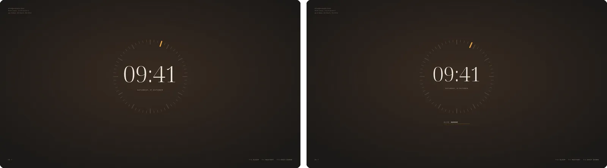

# Theme folders

Besides its own looks, the greeter draws theme folders: a `theme.toml` of
layers on a 3840 by 2160 frame, with the pictures, SVGs and fonts they
draw. They live outside the package, in
`/usr/local/share/gpui-greeter/themes`, one folder per theme, and
`theme = "<name>"` in the settings selects one. Every theme folder is a
lock screen too.

<p></p>

[dial](../skills/gpui-greeter-theme/dial), the example, is some 350 lines
of commented `theme.toml`, four SVGs and a font: a clock in a ring of
sixty ticks, one of them lit and moving with the seconds, the form beneath
it.

## What a theme can do

Layers anchor to the screen's edges, its corners or its centre, so a
theme holds on a 16:10, a 21:9 or a smaller monitor as well as on a
27-inch 4K one. A layer is text, the password field, a picture, an SVG (in
one colour that states can change and turn, or in its own), the wallpaper
the settings pick, sharp or blurred, a slideshow, or panes laid out as
xmonad lays out windows; boxes arrange layers in rows, columns and stacks.
Each layer can look different in each state of the login (at rest,
waiting, typing, checking, refused), when it is the lock screen, under
the pointer, or while a power action waits for its second press, and
changes between them over a transition. Motions move layers by keyframes,
as CSS animations do, and can keep time with the clock.

Text fills in the time and the date in either language, the user, the
session, what PAM says, and facts about the machine: its name, system,
kernel, uptime, CPU, GPU, memory, packages and network, read from files.
A theme never runs anything, and fetches nothing at login.

[The format](../skills/gpui-greeter-theme/reference.md) documents every
key, beside the example.

## Check, preview, install

```sh
gpui-greeter check-theme DIR
gpui-greeter preview DIR --state error --lang zh-CN --shot error.png
sudo gpui-greeter install-theme DIR --select
```

`check-theme` reads the folder as the greeter would and names what is
wrong by file and line. A theme with an error is never drawn: the greeter
shows Paper instead and logs why, so a broken theme cannot keep anyone
from logging in.

`preview` shows the theme against a fake greetd that takes the password
`test`, in a window of the running session; with `--shot` it needs no
display, drawing in an Xvfb of its own with lavapipe, and writes a
screenshot once the screen settles. `--state` shows the theme in one
state, `rest`, `idle` (waiting), `typing`, `checking` or `error`
(refused); `--lang` shows it in English or Chinese, `--size` on another
screen and `--lock` as the lock screen, and `--user` and `--host` stand
in for the real names. `--press` and `--hover` press its keys and point
at its controls before the screenshot.

`install-theme` checks the folder again and copies its files, owned by
root and readable by the greeter, to the themes folder; `--select` sets
`theme` in the settings, keeping their comments. Without root, `--to DIR`
makes a dry run into a folder of your own, listing what it copies and what
it leaves behind.

## Switching looks

At the login screen and the lock screen, F9 switches to the next look and
Shift+F9 back: the built-in looks, then the installed theme folders by
name, or the list in `[themes] cycle`. Paper and Neon also show a quiet
control for it beside their session. The greeter keeps the choice, under
`/var/lib/gpui-greeter` for the login screen and in
`~/.local/state/gpui-greeter/lock.toml` for the lock, and starts with it
next time, until the settings' `theme` changes.

## Designing a theme with an agent

The idea is borrowed from [Omarchy](https://omarchy.org), where a theme is a
folder on your own machine that restyles the whole desktop, and Omarchy ships
skills that help your coding agent make new ones. Here it is the login screen
and the lock screen.

The package comes with a skill, `gpui-greeter-theme`, that walks an agent
such as Claude Code through designing a theme with you: drawing out the
idea, gathering fonts and pictures lawfully and recording where each came
from, laying it out at macOS's sizes, previewing every state in both
languages and as the lock screen, and installing it. Add it to Claude Code
with

```sh
mkdir -p ~/.claude/skills
ln -s /usr/share/gpui-greeter/skills/gpui-greeter-theme ~/.claude/skills/
```

and ask it for a new login screen: a mockup, a desktop you like, a game, a
colour scheme or a wallpaper is enough to start from. Your themes stay in
a folder of your own, such as
`~/.local/share/gpui-greeter/themes-src/<name>`, and on your machine:
pictures and logos that are yours to use but not to share never go into
the package. The README's XMonad Bind, XMonad Tall and Arch Linux Console
were made this way, and stay on their author's machine for that reason:
they draw the xmonad and Arch Linux logos.
